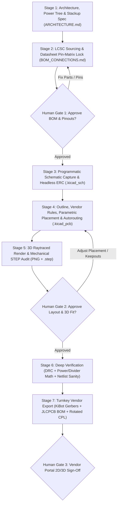

# <span style="color: #88C0D0;">**End-to-End AI PCB Design Playbook: Prompts, Gates & Vendor Handoff**</span>

### <span style="color: #81A1C1;">**Filename:** `ai_pcb_design_playbook.md`</span>

| <span style="color: #EBCB8B;">**Field**</span> | <span style="color: #EBCB8B;">**Details**</span> |
| :--- | :--- |
| <span style="color: #EBCB8B;">**Author**</span> | devilsu |
| <span style="color: #EBCB8B;">**Created**</span> | 2026-11-19 17:33 PST |
| <span style="color: #EBCB8B;">**Modified**</span> | 2026-11-19 17:43 PST |
| <span style="color: #EBCB8B;">**Version**</span> | v1.1.0 |
| <span style="color: #EBCB8B;">**Status**</span> | <span style="color: #A3BE8C;">**Active Workflow Playbook**</span> |
| <span style="color: #EBCB8B;">**Target Toolchain**</span> | KiCad 9 (`kicad-cli`, `pcbnew`) + `.venv` (`circuit-synth`, `kicad-sch-api`, `KiBot`, `Freerouting`) |
| <span style="color: #EBCB8B;">**Verification Gates**</span> | 3 Mandatory Human Sign-Off Gates (BOM/Pinout, 3D Mechanical, Vendor Portal) |

---

## <span style="color: #88C0D0;">**Table of Contents**</span>
- [<span style="color: #88C0D0;">**1. Core Principle & 7-Stage Pipeline Overview**</span>](#1-core-principle--7-stage-pipeline-overview)
  - [<span style="color: #81A1C1;">1.1 Gated Multi-Stage Prompting Rule</span>](#11-gated-multi-stage-prompting-rule)
  - [<span style="color: #81A1C1;">1.2 End-to-End Workflow Diagram</span>](#12-end-to-end-workflow-diagram)
- [<span style="color: #88C0D0;">**2. Stage 1: Planning & Architecture (`ARCHITECTURE.md`)**</span>](#2-stage-1-planning--architecture-architecturemd)
  - [<span style="color: #81A1C1;">2.1 Engineering Actions & Scope</span>](#21-engineering-actions--scope)
  - [<span style="color: #81A1C1;">2.2 Stage 1 Practitioner Prompt</span>](#22-stage-1-practitioner-prompt)
- [<span style="color: #88C0D0;">**3. Stage 2: Part Selection & Datasheet Pinout Gate (`BOM_CONNECTIONS.md`)**</span>](#3-stage-2-part-selection--datasheet-pinout-gate-bom_connectionsmd)
  - [<span style="color: #81A1C1;">3.1 Anti-Hallucination Sourcing & Pin Matrix</span>](#31-anti-hallucination-sourcing--pin-matrix)
  - [<span style="color: #81A1C1;">3.2 Stage 2 Practitioner Prompt & Human Gate 1</span>](#32-stage-2-practitioner-prompt--human-gate-1)
- [<span style="color: #88C0D0;">**4. Stage 3: Schematic Capture & Headless ERC (`.kicad_sch`)**</span>](#4-stage-3-schematic-capture--headless-erc-kicad_sch)
  - [<span style="color: #81A1C1;">4.1 Programmatic Schematic Synthesis</span>](#41-programmatic-schematic-synthesis)
  - [<span style="color: #81A1C1;">4.2 Stage 3 Practitioner Prompt</span>](#42-stage-3-practitioner-prompt)
- [<span style="color: #88C0D0;">**5. Stage 4: Board Layout, Placement, Routing & Planes (`.kicad_pcb`)**</span>](#5-stage-4-board-layout-placement-routing--planes-kicad_pcb)
  - [<span style="color: #81A1C1;">5.1 Deterministic Four-Step Layout Sequence</span>](#51-deterministic-four-step-layout-sequence)
  - [<span style="color: #81A1C1;">5.2 Stage 4 Practitioner Prompt</span>](#52-stage-4-practitioner-prompt)
- [<span style="color: #88C0D0;">**6. Stage 5: 3D Render & Mechanical Audit (`PNG` & `.step`)**</span>](#6-stage-5-3d-render--mechanical-audit-png--step)
  - [<span style="color: #81A1C1;">6.1 Physical Clearance & Silkscreen Inspection</span>](#61-physical-clearance--silkscreen-inspection)
  - [<span style="color: #81A1C1;">6.2 Stage 5 Practitioner Prompt & Human Gate 2</span>](#62-stage-5-practitioner-prompt--human-gate-2)
- [<span style="color: #88C0D0;">**7. Stage 6: Pre-Flight Electrical, Thermal & DFM Audit (`AUDIT.md`)**</span>](#7-stage-6-pre-flight-electrical-thermal--dfm-audit-auditmd)
  - [<span style="color: #81A1C1;">7.1 Beyond Geometric DRC: Circuit Physics & Divider Math</span>](#71-beyond-geometric-drc-circuit-physics--divider-math)
  - [<span style="color: #81A1C1;">7.2 Stage 6 Practitioner Prompt</span>](#72-stage-6-practitioner-prompt)
- [<span style="color: #88C0D0;">**8. Stage 7: Turnkey Vendor Export & Portal Sign-Off**</span>](#8-stage-7-turnkey-vendor-export--portal-sign-off)
  - [<span style="color: #81A1C1;">8.1 Production Package & SMT Rotation Offsets</span>](#81-production-package--smt-rotation-offsets)
  - [<span style="color: #81A1C1;">8.2 Stage 7 Practitioner Prompt & Human Gate 3</span>](#82-stage-7-practitioner-prompt--human-gate-3)

---

## <span style="color: #88C0D0;">**1. Core Principle & 7-Stage Pipeline Overview**</span>

### <span style="color: #81A1C1;">**1.1 Gated Multi-Stage Prompting Rule**</span>

> [!IMPORTANT]
> **The #1 Rule Used by Successful Practitioners: Gated Multi-Stage Prompting**
> Experienced hardware engineers **never** issue a single prompt like *"Design me a 16-channel microphone array PCB and export Gerbers."* One-shot prompting leads to hallucinated IC pin numbers, out-of-stock parts, missing boot/strapping resistors, and rotated SMT footprints. Instead, practitioners run a **7-stage gated pipeline** where the AI writes explicit intermediate markdown specs (`ARCHITECTURE.md`, `BOM_CONNECTIONS.md`, `AUDIT.md`) and pauses at **three mandatory human verification gates**.

### <span style="color: #81A1C1;">**1.2 End-to-End Workflow Diagram**</span>



---

## <span style="color: #88C0D0;">**2. Stage 1: Planning & Architecture (`ARCHITECTURE.md`)**</span>

### <span style="color: #81A1C1;">**2.1 Engineering Actions & Scope**</span>

Before picking exact footprints or touching KiCad, the engineer prompts the AI to nail down functional blocks, the power budget, signal integrity constraints, mechanical dimensions, and the PCB layer stackup (e.g., 2-layer vs. 4-layer `Sig - GND - PWR - Sig`).

### <span style="color: #81A1C1;">**2.2 Stage 1 Practitioner Prompt**</span>

```text
We are designing a 4-layer circular 8-channel digital PDM MEMS microphone array board (80 mm diameter, M3 mounting holes) that connects to an FPGA host over a 2x10 2.54 mm IDC header, powered from 5V on the header with an ultra-low-noise 3.3V LDO on-board.

Do NOT create any KiCad files yet. Write `ARCHITECTURE.md` covering:
1. Functional block diagram and signal grouping (4 stereo PDM pairs sharing buffered PDM_CLK).
2. Power tree, current budget, LDO dropout/thermal margin, and per-IC decoupling strategy.
3. Clock fanout & signal-integrity plan (series termination resistors on PDM_CLK/DATA, solid internal GND reference plane).
4. Recommended 4-layer JLCPCB impedance/stackup choice (e.g., JLC04161H-7628) and mechanical keepouts (bottom-port vs. top-port mic acoustic holes).
Stop for my review once `ARCHITECTURE.md` is written.
```

---

## <span style="color: #88C0D0;">**3. Stage 2: Part Selection & Datasheet Pinout Gate (`BOM_CONNECTIONS.md`)**</span>

### <span style="color: #81A1C1;">**3.1 Anti-Hallucination Sourcing & Pin Matrix**</span>

This is the <span style="color: #EBCB8B;">**most critical anti-hallucination step**</span>. Practitioners instruct the AI to:

1. Select real parts stocked at LCSC/JLCPCB, prioritizing <span style="color: #EBCB8B;">**JLCPCB "Basic" parts**</span> (zero feeder setup fee) for passives/regulators/ESD diodes over <span style="color: #EBCB8B;">**"Extended" parts**</span> (which incur a \$3 feeder loading fee per unique part type at JLCPCB).
2. Download or read the actual PDF datasheets for every non-trivial IC/sensor/connector and transcribe an explicit <span style="color: #EBCB8B;">**pin-by-pin table**</span> (`Pin #`, `Datasheet Name`, `Electrical Type`, `Connected Net`) into `BOM_CONNECTIONS.md`.
3. Fetch missing symbols/footprints/3D models into a local project library via `easyeda2kicad --full --lcsc_id=Cxxxx`.

### <span style="color: #81A1C1;">**3.2 Stage 2 Practitioner Prompt & Human Gate 1**</span>

```text
`ARCHITECTURE.md` is approved. Now perform part selection and pinout verification:
1. Propose specific MPNs and in-stock LCSC part numbers (`Cxxxx`), using JLCPCB 'Basic' parts for all R/C passives, ESD arrays, and buffers where possible, and flagging every 'Extended' part.
2. Fetch and read the PDF datasheets for the MEMS microphone, clock buffer, and LDO. Verify supply voltage ranges, L/R channel-select strapping pins, and acoustic port location (top vs. bottom port).
3. Write `BOM_CONNECTIONS.md` containing the full BOM table and an explicit pin-by-pin net assignment table for every IC and the 2x10 FPGA header.
Do NOT generate schematic files until I approve `BOM_CONNECTIONS.md`.
```

> [!WARNING]
> **Human Gate 1 (Datasheet Cross-Check):** Practitioners spend 3–5 minutes checking IC pin numbers, `L/R` strapping pins, connector pinout mirroring (male vs. female header orientation), and active-low enable/reset pins in `BOM_CONNECTIONS.md`. Fixing a swapped pin here takes 5 seconds; missing it ruins the fabricated board.

---

## <span style="color: #88C0D0;">**4. Stage 3: Schematic Capture & Headless ERC (`.kicad_sch`)**</span>

### <span style="color: #81A1C1;">**4.1 Programmatic Schematic Synthesis**</span>

Once `BOM_CONNECTIONS.md` is locked, the AI writes a deterministic Python script (using `circuit-synth` / `kicad-sch-api` or `SKiDL`) to generate clean, modular `.kicad_sch` sheets, exports the schematic to SVG/PNG, visually inspects the rendered schematic image for overlapping text/wires, and iterates until headless `kicad-cli sch erc` passes cleanly.

### <span style="color: #81A1C1;">**4.2 Stage 3 Practitioner Prompt**</span>

```text
`BOM_CONNECTIONS.md` is approved.
1. Pull any missing custom symbols/footprints/3D models into `hw/libs/` using `easyeda2kicad` and configure project-local `sym-lib-table` and `fp-lib-table`.
2. Write a Python generator using `kicad-sch-api` / `circuit-synth` to build clean, readable schematic sheets (Power & LDO, Clock Buffer & Header, and 8x MEMS Mic Channels with local 100 nF + 1 uF decoupling). Embed each part's `LCSC` field directly in symbol properties.
3. Run `kicad-cli sch erc --format json --severity-error`, export the schematic sheets to PNG via `kicad-cli sch export svg` + `rsvg-convert`, inspect the PNGs visually for readability, and resolve all ERC errors/warnings.
```

---

## <span style="color: #88C0D0;">**5. Stage 4: Board Layout, Placement, Routing & Planes (`.kicad_pcb`)**</span>

### <span style="color: #81A1C1;">**5.1 Deterministic Four-Step Layout Sequence**</span>

Practitioners never let an LLM guess raw trace coordinates by hand. Instead, they split physical board design into four deterministic sub-steps:

1. <span style="color: #EBCB8B;">**Load Vendor DRC Constraints First:**</span> Configure `.kicad_pro` with safe fab margins (e.g., JLCPCB 4-layer conservative rules: `0.15 mm` min track/clearance, `0.3 mm` drill / `0.6 mm` pad vias, `0.3 mm` edge clearance) so every subsequent step is policed by real fab limits.
2. <span style="color: #EBCB8B;">**Board Outline & Parametric Placement (`pcbnew`):**</span> Use Python trigonometry to draw `Edge.Cuts` (circles, slots, rounded corners), place M3 mounting holes, position the 8 mics at exact `45 deg` polar coordinates (`R = 35 mm`), place each `100 nF` decoupling cap within `< 1.5 mm` of its IC `VDD` pin, and place ESD diodes right at the connector pads.
3. <span style="color: #EBCB8B;">**Trace Routing (`pcbnew` + `Freerouting`):**</span> Script critical symmetric clock/power trunks or export Specctra `.dsn` to headless `Freerouting` (`freerouting.jar`) to route all remaining signal nets, then import `.ses`.
4. <span style="color: #EBCB8B;">**Planes & Stitching Vias:**</span> Pour continuous `GND` (`In1.Cu`, `B.Cu`) and `3V3` (`In2.Cu`) copper zones via `pcbnew.ZONE_FILLER` and place ground-return stitching vias around the board perimeter and beside signal layer transitions.

### <span style="color: #81A1C1;">**5.2 Stage 4 Practitioner Prompt**</span>

```text
Proceed to 4-layer PCB layout (`F.Cu`: Signals/Components, `In1.Cu`: Solid GND, `In2.Cu`: 3V3 Power, `B.Cu`: Bottom Signals + GND pour):
1. Configure JLCPCB 4-layer DRC rules (`0.15 mm` min trace/space, `0.5 mm` power traces, `0.3/0.6 mm` vias).
2. Script `Edge.Cuts` (80 mm circle), 4x M3 mounting holes, acoustic port keepouts if bottom-ported, and exact polar placement for the 8 mics (`R = 35 mm`, every 45 degrees) with tight local decoupling (`< 2 mm` from VDD).
3. Export `.dsn`, run headless `Freerouting` to 0 unrouted nets, import `.ses`, refill all copper zones, and add perimeter/return GND stitching vias.
4. Export per-layer copper/silkscreen PNGs and run `kicad-cli pcb drc --format json` until 0 DRC violations and 0 unconnected nets remain.
```

---

## <span style="color: #88C0D0;">**6. Stage 5: 3D Render & Mechanical Audit (`PNG` & `.step`)**</span>

### <span style="color: #81A1C1;">**6.1 Physical Clearance & Silkscreen Inspection**</span>

Passing 2D DRC does <span style="color: #EBCB8B;">**not**</span> catch mechanical mistakes—such as a USB-C receptacle recessed too far inland so a cable plug hits the board edge, silkscreen labels printed over exposed solder pads or acoustic holes, or tall electrolytic caps colliding with a ribbon cable latch. Practitioners generate multi-angle raytraced 3D PNGs (`kicad-cli pcb render`) and a full `.step` assembly (`kicad-cli pcb export step`).

### <span style="color: #81A1C1;">**6.2 Stage 5 Practitioner Prompt & Human Gate 2**</span>

```text
Generate top, bottom, and 45-degree isometric 3D raytraced renders using `kicad-cli pcb render --quality high` along with a full 3D `.step` mechanical model:
1. Visually inspect all 3D PNGs to verify connector overhang/orientation, silkscreen legibility, Pin-1 dot visibility next to every IC, and zero silkscreen overlapping pads or mic ports.
2. Share the rendered images so I can review the layout and 3D mechanical fit before final sign-off.
```

> [!NOTE]
> **Human Gate 2 (Interactive GUI / 3D Inspection):** At this gate, engineers typically open the `.kicad_pcb` in KiCad's GUI for 5 minutes—spinning the 3D viewer (`Alt+3`) and optionally tweaking 1–2 high-speed/clock traces with KiCad's push-and-shove router if needed.

---

## <span style="color: #88C0D0;">**7. Stage 6: Pre-Flight Electrical, Thermal & DFM Audit (`AUDIT.md`)**</span>

### <span style="color: #81A1C1;">**7.1 Beyond Geometric DRC: Circuit Physics & Divider Math**</span>

Because KiCad's built-in DRC only checks geometric spacing and netlist connectivity—not *whether your circuit physics actually works*—practitioners run a dedicated pre-flight verification prompt (or `kicad-happy` / Python audit script) checking analog math, strapping resistors, and DFM traps. For example, for adjustable regulators, the AI programmatically verifies feedback divider tolerances against datasheet reference voltages:

$$
V_{\text{out}} = V_{\text{ref}} \left(1 + \frac{R_{\text{top}}}{R_{\text{bot}}}\right)
$$

### <span style="color: #81A1C1;">**7.2 Stage 6 Practitioner Prompt**</span>

```text
Perform an independent pre-flight engineering audit of `.kicad_sch` and `.kicad_pcb` and write `AUDIT.md`:
1. Re-run `kicad-cli sch erc` and `kicad-cli pcb drc --schematic-parity` to confirm 100% schematic-to-PCB parity, 0 unconnected pads, and 0 DRC violations.
2. Audit electrical sanity: verify LDO output voltage math/pinout, confirm stereo PDM mic pairs have opposite `L/R` strapping levels on each shared data line, check I2C/reset pull-ups, and verify power trace widths against peak current (IPC-2221).
3. Check DFM hazards: isolated copper islands, vias inside SMT pads without VIPPO specification, silkscreen-on-pad, and minimum annular rings.
```

---

## <span style="color: #88C0D0;">**8. Stage 7: Turnkey Vendor Export & Portal Sign-Off**</span>

### <span style="color: #81A1C1;">**8.1 Production Package & SMT Rotation Offsets**</span>

To order assembled boards (PCBA), vendors like JLCPCB require three synchronized files:

1. <span style="color: #EBCB8B;">**`gerbers.zip`:**</span> Copper layers (`F.Cu`, `In1.Cu`, `In2.Cu`, `B.Cu`), solder mask, silkscreen, paste, `Edge.Cuts`, and Excellon `.drl` PTH/NPTH drill files.
2. <span style="color: #EBCB8B;">**`bom_jlcpcb.csv`:**</span> Exact columns `Comment, Designator, Footprint, LCSC Part #`.
3. <span style="color: #EBCB8B;">**`cpl_jlcpcb.csv` (Pick-and-Place):**</span> Exact columns `Designator, Mid X, Mid Y, Layer, Rotation`.

Crucially, KiCad's default IPC-7351 footprint zero-rotation angles often differ by `90 deg` or `180 deg` from JLCPCB's SMT pick-and-place tape orientation (especially on SOT-23 regulators, diodes, QFN packages, and MEMS mics). Running <span style="color: #EBCB8B;">**`KiBot`**</span> (with its built-in `jlcpcb` position rotation filter) automatically applies known `JLC-rotations` corrections and bundles all fabrication + assembly files cleanly.

### <span style="color: #81A1C1;">**8.2 Stage 7 Practitioner Prompt & Human Gate 3**</span>

```text
`AUDIT.md` looks clean. Generate the turnkey JLCPCB PCBA release package in `hw/fab_release/` using `KiBot` (or `kicad-cli` + JLCPCB CPL rotation rules):
1. Export `gerbers.zip` (Gerber X2 + Excellon drills), `bom_jlcpcb.csv`, `cpl_jlcpcb.csv`, and an `ibom.html` interactive assembly map.
2. Verify every populated SMT component in `bom_jlcpcb.csv` has a valid `Cxxxx` LCSC number, summarize total unique Basic vs. Extended parts, and flag any footprints requiring manual Pin-1 rotation attention in JLCPCB's previewer.
```

> [!CAUTION]
> **Human Gate 3 (Mandatory Vendor Portal 3D Placement Preview):** Never skip JLCPCB's (or PCBWay's) interactive online PCBA placement viewer after uploading `gerbers.zip`, `bom_jlcpcb.csv`, and `cpl_jlcpcb.csv`. Always visually confirm **Pin-1 dots, diode cathode bars, connector orientations, and MEMS mic acoustic port alignment** in the vendor's live 2D/3D render—clicking the `"Rotate 90°"` button in their web UI if any IC is rotated—before paying for fabrication.
