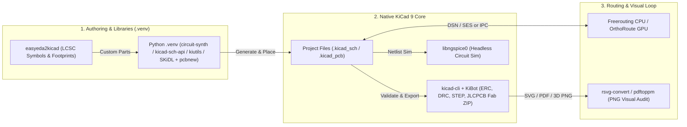

# <span style="color: #88C0D0;">**AI-Driven KiCad 9 PCB Design Toolchain Setup Guide**</span>

### <span style="color: #81A1C1;">**Filename:** `kicad_setup_guide.md`</span>

| <span style="color: #EBCB8B;">**Field**</span> | <span style="color: #EBCB8B;">**Details**</span> |
| :--- | :--- |
| <span style="color: #EBCB8B;">**Author**</span> | devilsu |
| <span style="color: #EBCB8B;">**Created**</span> | 2026-11-19 17:08 PST |
| <span style="color: #EBCB8B;">**Modified**</span> | 2026-11-19 17:43 PST |
| <span style="color: #EBCB8B;">**Version**</span> | v1.3.0 |
| <span style="color: #EBCB8B;">**Status**</span> | <span style="color: #A3BE8C;">**Active Reference & Setup Guide**</span> |
| <span style="color: #EBCB8B;">**OS / Architecture**</span> | Ubuntu 26.04.1 LTS (`resolute`, `x86_64`) |
| <span style="color: #EBCB8B;">**APT KiCad Candidate**</span> | `kicad 9.0.8+dfsg-1` (Official Ubuntu `universe` repo — no PPA needed) |
| <span style="color: #EBCB8B;">**System Python**</span> | `Python 3.14.4` (`/usr/bin/python3`, matches APT `libpython3.14` linkage) |
| <span style="color: #EBCB8B;">**Workspace Python Standard**</span> | `setup_env.sh` + `python3 -m venv --system-site-packages .venv` + `requirements.txt` (matches `mic_arr_spatial`, `realtime_anc`, and `mic_arr_v2`) |
| <span style="color: #EBCB8B;">**Pre-installed Utilities**</span> | `python3.14-venv`, `pip3`, `pdftoppm`, NVIDIA GPU driver (`.nv`) |

---

## <span style="color: #88C0D0;">**Table of Contents**</span>
- [<span style="color: #88C0D0;">**1. Architecture Overview & Native APT Requirement**</span>](#1-architecture-overview--native-apt-requirement)
  - [<span style="color: #81A1C1;">1.1 Native APT vs. Sandboxed Builds</span>](#11-native-apt-vs-sandboxed-builds)
  - [<span style="color: #81A1C1;">1.2 Toolchain Dataflow Diagram</span>](#12-toolchain-dataflow-diagram)
- [<span style="color: #88C0D0;">**2. Step-by-Step Host Setup Process**</span>](#2-step-by-step-host-setup-process)
  - [<span style="color: #81A1C1;">2.1 Install Native KiCad 9 & Component Libraries (`apt`)</span>](#21-install-native-kicad-9--component-libraries-apt)
  - [<span style="color: #81A1C1;">2.2 Configure Python PCB Environment (`setup_env.sh` & `requirements.txt`)</span>](#22-configure-python-pcb-environment-setup_envsh--requirementstxt)
  - [<span style="color: #81A1C1;">2.3 Install Visual Inspection, Autorouting & Fab Helpers</span>](#23-install-visual-inspection-autorouting--fab-helpers)
  - [<span style="color: #81A1C1;">2.4 Initialize Global Library Tables & Run Smoke Verification</span>](#24-initialize-global-library-tables--run-smoke-verification)
- [<span style="color: #88C0D0;">**3. Setup Tiers & Capability Comparison**</span>](#3-setup-tiers--capability-comparison)
  - [<span style="color: #81A1C1;">3.1 Side-by-Side Metric & Capability Matrix</span>](#31-side-by-side-metric--capability-matrix)
  - [<span style="color: #81A1C1;">3.2 Per-Add-On Storage Breakdown & Hybrid Option</span>](#32-per-add-on-storage-breakdown--hybrid-option)

---

## <span style="color: #88C0D0;">**1. Architecture Overview & Native APT Requirement**</span>

### <span style="color: #81A1C1;">**1.1 Native APT vs. Sandboxed Builds**</span>

> [!IMPORTANT]
> **Install KiCad natively via `apt` — NOT via Snap or Flatpak.**
> Containerized Snap/Flatpak builds sandbox the filesystem and trap KiCad's C++ `pcbnew` Python module inside an isolated runtime. Native `apt` installation exposes `/usr/bin/kicad-cli` globally and installs `pcbnew` directly into `/usr/lib/python3/dist-packages` for `Python 3.14`.

### <span style="color: #81A1C1;">**1.2 Toolchain Dataflow Diagram**</span>



---

## <span style="color: #88C0D0;">**2. Step-by-Step Host Setup Process**</span>

### <span style="color: #81A1C1;">**2.1 Install Native KiCad 9 & Component Libraries (`apt`)**</span>

Ubuntu 26.04 ships <span style="color: #EBCB8B;">**KiCad 9.0.8**</span> natively in `universe`, compiled with OpenCASCADE (`STEP` 3D export), `libngspice0` (SPICE simulation), and `Python 3.14` bindings.

1. <span style="color: #EBCB8B;">**Core package + schematic symbols, footprints, and templates**</span> (~135 MB binary + standard 2D libraries):
   ```bash
   sudo apt update
   sudo apt install kicad kicad-libraries
   ```
2. <span style="color: #EBCB8B;">**Optional 3D mechanical models (`kicad-packages3d`)**</span>:
   ```bash
   sudo apt install kicad-packages3d
   ```

> [!NOTE]
> `kicad-packages3d` is a ~361 MB download (~4.8 GB unpacked on disk). It is optional for 2D PCB fabrication (Gerbers/drills/CPL), but required if you want populated 3D `STEP` mechanical exports or photorealistic `kicad-cli pcb render` board images with 3D component bodies.

### <span style="color: #81A1C1;">**2.2 Configure Python PCB Environment (`setup_env.sh` & `requirements.txt`)**</span>

Your existing convention across `mic_arr_spatial`, `realtime_anc`, and `mic_arr_v2` (`python3 -m venv --system-site-packages .venv` + `pip install -r requirements.txt`) works out of the box with `apt` KiCad: `--system-site-packages` exposes `/usr/lib/python3/dist-packages/pcbnew.py` inside `.venv`, while `requirements.txt` keeps pure-Python CAD packages isolated per project or `hw/subprojects/<board>/` directory.

1. <span style="color: #EBCB8B;">**Create `requirements.txt` in your PCB project/subproject directory**</span>:
   - `kicad-sch-api` & `circuit-synth`: MIT-licensed Python libraries for generating <span style="color: #EBCB8B;">**clean, Manhattan-wired, human-readable `.kicad_sch` schematics**</span> with native format preservation and bidirectional KiCad sync.
   - `kiutils`: Low-level Python dataclasses for parsing/modifying `.kicad_pcb`, `.kicad_mod` footprints, and library tables.
   - `skidl`: Python HDL-style netlist authoring and programmatic electrical rule checking.
   - `kicad-python`: Official KiCad 9 IPC API client (`kipy`) for live interaction when the KiCad GUI is open.
   - `easyeda2kicad`: CLI/library fetcher for importing symbols, footprints, and 3D models directly by LCSC part number (`easyeda2kicad --full --lcsc_id=C2040`).
   - `kibot` & `InteractiveHtmlBom`: Optional declarative pre-flight + turnkey JLCPCB/PCBWay Gerber/BOM/CPL archive packager and interactive HTML assembly viewer.
   ```text
   kicad-sch-api
   circuit-synth
   kiutils
   skidl
   kicad-python
   easyeda2kicad
   kibot
   InteractiveHtmlBom
   ```
2. <span style="color: #EBCB8B;">**Create `setup_env.sh` (matching your existing project template)**</span>:
   ```bash
   #!/bin/bash
   # ==============================================================================
   # Setup virtual environment and dependencies for KiCad PCB automation
   # ==============================================================================
   set -e

   SCRIPT_DIR="$(cd "$(dirname "${BASH_SOURCE[0]}")" && pwd)"
   VENV_DIR="${SCRIPT_DIR}/.venv"

   echo "=== Setting up KiCad Python virtual environment ==="
   if [ ! -d "${VENV_DIR}" ]; then
       echo "Creating virtual environment at ${VENV_DIR}..."
       python3 -m venv --system-site-packages "${VENV_DIR}"
   else
       echo "Existing virtual environment found at ${VENV_DIR}."
   fi

   echo "Installing / upgrading dependencies..."
   "${VENV_DIR}/bin/pip" install --upgrade pip
   "${VENV_DIR}/bin/pip" install -r "${SCRIPT_DIR}/requirements.txt"

   echo "Verifying KiCad pcbnew + CAD libraries..."
   "${VENV_DIR}/bin/python" -c "
   import pcbnew
   import kicad_sch_api
   import kiutils
   import skidl
   import kipy
   print(f'pcbnew:        {pcbnew.Version()}')
   print(f'kiutils:       {kiutils.__version__}')
   print(f'skidl:         {skidl.__version__}')
   print('KiCad Python environment verification SUCCESSFUL!')
   "

   echo "=== Setup complete! Activate with: source ${VENV_DIR}/bin/activate ==="
   ```

> [!TIP]
> **Why `python3 -m venv --system-site-packages` instead of Conda?**
> Avoid mixing `apt`-installed KiCad with a Conda Python environment—`apt`'s C++ `pcbnew` binary links against Ubuntu's `/usr/bin/python3.14` and system `wxWidgets`, which causes ABI errors inside Conda's Python binary. (If you ever worked on a Conda-only machine without `apt` access, you would instead install KiCad itself from `conda-forge` via `conda create -n kicad -c conda-forge kicad` so both `kicad-cli` and `pcbnew` share the Conda ABI.)

### <span style="color: #81A1C1;">**2.3 Install Visual Inspection, Autorouting & Fab Helpers**</span>

To let me visually inspect schematic sheets, silkscreen placement, and copper routing—and auto-route multi-net boards—install these CLI helpers:

1. <span style="color: #EBCB8B;">**SVG-to-PNG rasterizer (`librsvg2-bin`)**</span>:
   Your machine already has `/usr/bin/pdftoppm`, and KiCad 9's `kicad-cli pcb render` outputs 3D PNGs directly. Adding `rsvg-convert` allows crisp, arbitrary-DPI PNG conversion of 2D schematic and per-layer copper SVGs (`kicad-cli sch export svg` / `pcb export svg`):
   ```bash
   sudo apt install librsvg2-bin
   ```
2. <span style="color: #EBCB8B;">**Headless `Freerouting` CLI Autorouter (Standard 2–6 Layer Boards)**</span>:
   `freerouting` is distributed as a portable Java `.jar` rather than an Ubuntu `apt` package:
   - Install the headless Java runtime (`OpenJDK 25` on Ubuntu 26.04):
     ```bash
     sudo apt install default-jre-headless
     ```
   - Download the latest `freerouting-x.y.z.jar` release from GitHub into `~/.local/share/freerouting/freerouting.jar`.
   - Workflow: Python `pcbnew.ExportSpecctraDSN()` exports `board.dsn` -> `java -Djava.awt.headless=true -jar freerouting.jar -de board.dsn -do board.ses` routes traces -> `pcbnew.ImportSpecctraSESSION()` writes copper tracks/vias back into `.kicad_pcb`.
3. <span style="color: #EBCB8B;">**Optional Future Add-On for Dense FPGA / BGA Boards (`bbenchoff/OrthoRoute`)**</span>:
   If a future board has high-pin-count FPGA BGA escapes or dense 6+ layer channel fanouts that stall CPU `Freerouting`, open-source `OrthoRoute` (`github.com/bbenchoff/OrthoRoute`) uses your NVIDIA GPU (`CUDA`/`CuPy`) over KiCad 9's IPC API to route dense Manhattan lattices.

### <span style="color: #81A1C1;">**2.4 Initialize Global Library Tables & Run Smoke Verification**</span>

Before running headless scripts for the very first time, KiCad needs its user config directory (`~/.config/kicad/9.0/`) populated with `sym-lib-table` and `fp-lib-table` pointing to `/usr/share/kicad/`:

1. <span style="color: #EBCB8B;">**Initialize library tables**</span>:
   Either launch the `kicad` GUI once and click *"Copy default global symbol/footprint library tables"* on the first-run prompt, <span style="color: #EBCB8B;">**or**</span> copy `/usr/share/kicad/template/sym-lib-table` and `/usr/share/kicad/template/fp-lib-table` directly into `~/.config/kicad/9.0/` via CLI (no GUI required):
   ```bash
   mkdir -p ~/.config/kicad/9.0
   cp -n /usr/share/kicad/template/sym-lib-table ~/.config/kicad/9.0/
   cp -n /usr/share/kicad/template/fp-lib-table ~/.config/kicad/9.0/
   ```
2. <span style="color: #EBCB8B;">**Run a 4-point CLI smoke check**</span>:
   ```bash
   # 1. Verify CLI version (expect 9.0.8)
   kicad-cli --version

   # 2. Run setup_env.sh and verify pcbnew + requirements inside .venv
   chmod +x setup_env.sh && ./setup_env.sh

   # 3. Verify global footprint & symbol tables exist
   ls -l ~/.config/kicad/9.0/sym-lib-table ~/.config/kicad/9.0/fp-lib-table

   # 4. Verify SVG rasterizer, KiBot, and Java runtime (if installed)
   rsvg-convert --version && .venv/bin/kibot --version && java -version
   ```

---

## <span style="color: #88C0D0;">**3. Setup Tiers & Capability Comparison**</span>

Both <span style="color: #EBCB8B;">**Minimal Core**</span> and <span style="color: #EBCB8B;">**Full Autonomous**</span> install the exact same <span style="color: #EBCB8B;">**KiCad 9.0.8**</span> core, 2D symbol/footprint libraries, `kicad-cli`, and `.venv` Python bindings (on your root NVMe, `245 GB` is currently free).

### <span style="color: #81A1C1;">**3.1 Side-by-Side Metric & Capability Matrix**</span>

| <span style="color: #EBCB8B;">**Metric / Capability**</span> | <span style="color: #EBCB8B;">**Minimal Core (`~765 MB`)**</span> | <span style="color: #EBCB8B;">**Full Autonomous (`~5.75 GB`)**</span> |
| :--- | :--- | :--- |
| <span style="color: #EBCB8B;">**Schematic Capture**</span> | Clean orthogonal `.kicad_sch` sheets via `kicad-sch-api` / `circuit-synth` + `SKiDL` ERC | Identical — clean orthogonal `.kicad_sch` sheets + `SKiDL` ERC |
| <span style="color: #EBCB8B;">**2D Fab Outputs & Rules Checks**</span> | `kicad-cli` Gerbers, drills, BOM, CPL, and headless JSON ERC/DRC | Adds `KiBot` (`kibot.yaml`) + `InteractiveHtmlBom` for one-command JLCPCB-formatted BOM/CPL/Gerber ZIPs |
| <span style="color: #EBCB8B;">**Copper Trace Routing**</span> | Explicit Python coordinate math (`pcbnew`) for regular arrays/breakouts, or manual GUI routing | Adds headless `Freerouting` (`~180 MB`, plus optional CUDA `OrthoRoute`) to auto-route multi-IC netlists to zero airwires |
| <span style="color: #EBCB8B;">**Custom Part Sourcing**</span> | Stock KiCad libraries only; missing ICs/MEMS mics/connectors must be hand-generated from datasheets | Adds `easyeda2kicad` (`<5 MB`) to fetch verified symbols, footprints, and 3D models directly by JLCPCB/LCSC part number (`Cxxxx`) |
| <span style="color: #EBCB8B;">**3D Renders & Mechanical `STEP`**</span> | Bare flat FR-4 PCB only (no 3D IC, header, or connector bodies in `.step` exports or `kicad-cli pcb render`) | Adds `kicad-packages3d` (`~4.8 GB` unpacked) for populated 3D raytraced collision/overhang audits and full enclosure `.step` assemblies |
| <span style="color: #EBCB8B;">**Total Unpacked Disk Usage**</span> | `~765 MB` | `~5.75 GB` (`~85%` of the difference is `kicad-packages3d` alone) |

### <span style="color: #81A1C1;">**3.2 Per-Add-On Storage Breakdown & Hybrid Option**</span>

| <span style="color: #EBCB8B;">**Add-On Component**</span> | <span style="color: #EBCB8B;">**Download / Unpacked Size**</span> | <span style="color: #EBCB8B;">**What You Lose If Omitted**</span> |
| :--- | :--- | :--- |
| `easyeda2kicad` + `kibot` + `InteractiveHtmlBom` | `~15 MB` / `~40 MB` | Instant LCSC `Cxxxx` part import, automated JLCPCB BOM/CPL column/rotation formatting, and HTML assembly map |
| `default-jre-headless` + `freerouting.jar` | `~50 MB` / `~180 MB` | Automated multi-pass Specctra `.dsn` -> `.ses` trace routing for non-trivial netlists |
| `kicad-packages3d` (`apt`) | `~361 MB` / `~4.8 GB` | Stock 3D component bodies in `kicad-cli pcb render` PNGs and mechanical `.step` exports |

> [!NOTE]
> **Lightweight Hybrid Option (`~970 MB` unpacked):** Because `easyeda2kicad`, `KiBot`, and `Freerouting` add roughly `220 MB` combined, skipping *only* `kicad-packages3d` gives you full autonomous schematic generation, LCSC part fetching, autorouting, and JLCPCB turnkey packaging in under `1 GB`.
