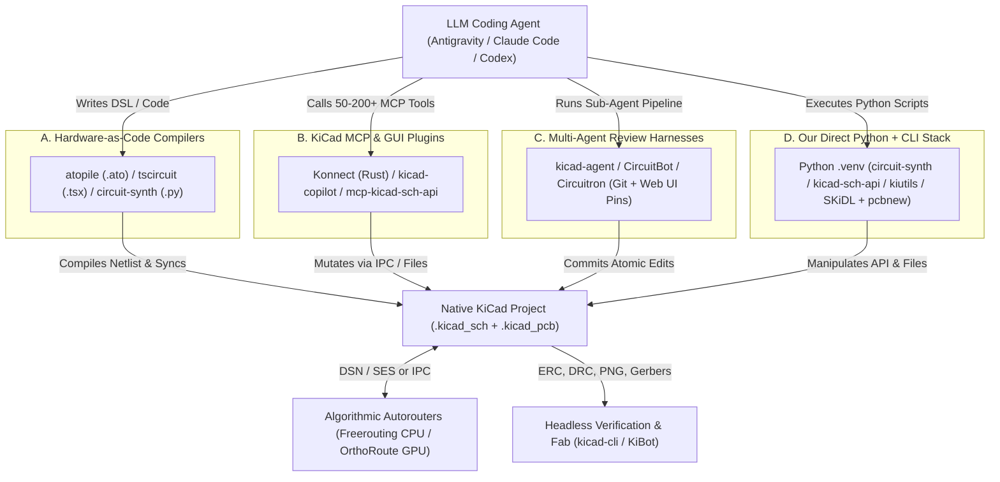

# **Open-Source AI PCB Design Landscape vs. Our KiCad 9 Setup**

### **Filename:** `open_source_ai_pcb_comparison.md`

| **Field** | **Details** |
| :--- | :--- |
| **Author** | devilsu |
| **Created** | 2026-11-19 17:24 PST |
| **Modified** | 2026-11-20 19:24 PST |
| **Version** | v1.1.0 |
| **Status** | **Active Ecosystem Research** |
| **Scope** | Open-Source / Non-Paid AI PCB Tools (2025–2026) vs. Native Ubuntu 26.04 KiCad 9 + `.venv` |

---

## **Table of Contents**
- [**1. The Four Open-Source AI PCB Workflows on GitHub**](#1-the-four-open-source-ai-pcb-workflows-on-github)
  - [1.1 Ecosystem Taxonomy Diagram](#11-ecosystem-taxonomy-diagram)
  - [1.2 Paradigm A: Hardware-as-Code (HaC) Compilers](#12-paradigm-a-hardware-as-code-hac-compilers)
  - [1.3 Paradigm B: KiCad MCP Servers & Native Action Plugins](#13-paradigm-b-kicad-mcp-servers--native-action-plugins)
  - [1.4 Paradigm C: Multi-Agent Harnesses with Git & Pin Review](#14-paradigm-c-multi-agent-harnesses-with-git--pin-review)
  - [1.5 Paradigm D: Open-Source Algorithmic / GPU Routing & CI Packaging](#15-paradigm-d-open-source-algorithmic--gpu-routing--ci-packaging)
- [**2. Step-by-Step Process Comparison: Community vs. Our Setup**](#2-step-by-step-process-comparison-community-vs-our-setup)
- [**3. Pros & Cons Comparison Matrix**](#3-pros--cons-comparison-matrix)
- [**4. Bottom-Line Verdict & Borrowed Open-Source Upgrades**](#4-bottom-line-verdict--borrowed-open-source-upgrades)

---

## **1. The Four Open-Source AI PCB Workflows on GitHub**

### **1.1 Ecosystem Taxonomy Diagram**

> [!IMPORTANT]
> **Key Takeaway Across Open-Source Repos (2025–2026)**
> Almost nobody in the open-source ecosystem lets an LLM emit raw `.kicad_pcb` or `.kicad_sch` S-expressions from scratch—raw coordinate hallucination causes broken pin connections and unreadable schematics. Instead, successful open-source workflows put a **deterministic abstraction layer** (a Python/DSL compiler, an MCP tool server, or `pcbnew` + an algorithmic autorouter) between the AI agent and KiCad, backed by `kicad-cli` DRC/ERC and rendered image feedback.

### **1.2 Paradigm A: Hardware-as-Code (HaC) Compilers**

Engineers and AI agents write declarative code rather than drawing schematics; a compiler validates constraints/types, selects passives, and syncs to `.kicad_pcb`:

- **`atopile` (merged with `faebryk`, MIT):** Declarative `.ato` + Python constraint solver (`V_out = 3.3V +/- 5%`) that calculates resistor dividers/decoupling automatically and syncs layout with KiCad.
- **`tscircuit` (MIT):** React/TypeScript (`.tsx`) circuit components with built-in browser preview, WebAssembly `ngspice`, autorouting, and KiCad export.
- **`circuit-synth` & `kicad-sch-api` (MIT, pure Python):** Built specifically for AI agents; generates **clean, Manhattan-wired, human-readable `.kicad_sch` sheets** that stay bidirectionally synced with KiCad, rather than dumping raw netlists.
- **`absmach/synth` (`SynthSpec`, Apache-2.0/MIT):** Concise `.synth` text spec compiled deterministically into KiCad projects.

### **1.3 Paradigm B: KiCad MCP Servers & Native Action Plugins**

Instead of writing one-off scripts, the AI talks to KiCad through structured Model Context Protocol (MCP) tool calls (similar in architecture to your existing `.vivado-mcp-server`):

- **`mixelpixx/Konnect` & `biosshot/kicad-copilot`:** Expose 50–200+ granular MCP tools (`place_symbol`, `add_wire`, `place_footprint`, `run_drc`, `export_gerbers`) over KiCad's IPC API and `kicad-cli`.
- **`circuit-synth/mcp-kicad-sch-api`:** Dedicated Python MCP server for schematic capture, hierarchical sheets, and orthogonal wire routing.
- **`paul356/KiCad-AI-Assistant` & `aklofas/kicad-happy`:** Embedded KiCad GUI chat panels and reusable agent skills for datasheet cross-checking, SPICE runs, and DFM audits.

### **1.4 Paradigm C: Multi-Agent Harnesses with Git & Pin Review**

- **`kicad-agent`, `CircuitBot` (LangGraph), `Circuitron`:** Wrap KiCad inside multi-agent pipelines (*Planner -> Part Finder -> SKiDL/Code Generator -> Validator*). `kicad-agent` commits every layout step to Git (rolling back automatically if DRC worsens) and serves a local Three.js web viewer where the human clicks a trace/pad to drop a spatial review comment for the agent's next pass.

### **1.5 Paradigm D: Open-Source Algorithmic / GPU Routing & CI Packaging**

Because LLMs are poor at raw geometric maze-solving across thousands of obstacles, virtually **all** open-source AI workflows hand off physical trace routing and fab packaging to deterministic backends:

- **`freerouting/freerouting` (GPL/Open Source, Java):** Industry-standard Specctra `.dsn`/`.ses` CPU autorouter for 2–6 layer boards.
- **`bbenchoff/OrthoRoute` (Open Source, Python + CUDA/CuPy):** GPU-accelerated Manhattan lattice autorouter using KiCad 9's IPC API—built specifically for dense BGA escapes, FPGA carrier boards, and high-channel-count arrays where CPU `Freerouting` stalls.
- **`PCBRouteAgent` / `PCBWorld` (Research / Open Source):** Multimodal LLM global planner driving KiCad's native push-and-shove router step-by-step via Gymnasium/RL wrappers.
- **`INTI-CMNB/KiBot` & `InteractiveHtmlBom` (GPL/MIT):** Single YAML config (`kibot.yaml`) that automates ERC/DRC pre-flight checks and packages exact manufacturer-formatted ZIPs (JLCPCB, PCBWay, OSH Park) plus interactive assembly HTML docs.

---

## **2. Step-by-Step Process Comparison: Community vs. Our Setup**

| **Design Stage** | **Typical Community HaC / MCP Process** | **Our Planned KiCad 9 + `.venv` Process** | **Key Difference** |
| :--- | :--- | :--- | :--- |
| **1. Architecture & Spec** | Prompt agent -> writes `.ato`, `.tsx`, or calls MCP `create_project` | Align on `blueprints/` markdown spec (like `mic_arr_v2`), then run deterministic Python generators | Ours matches your repo blueprint/evidence workflow without learning a custom `.ato`/`.tsx` language |
| **2. Part Sourcing** | `atopile` registry, `tscircuit` registry, or MCP JLCPCB search tools | Stock `/usr/share/kicad` + `easyeda2kicad --lcsc_id=Cxxxx` inside `.venv` | Equivalent LCSC/JLCPCB coverage with zero cloud registry dependency |
| **3. Schematic Capture** | `circuit-synth` / `kicad-sch-api` or MCP draws neat orthogonal `.kicad_sch` sheets; `atopile` skips visual schematics | `SKiDL` (code netlist/ERC) + `kiutils` (raw `.kicad_sch` S-expression manipulation) | **Gap in our initial plan:** `SKiDL` + raw `kiutils` produce messy visual schematics unless paired with `kicad-sch-api` |
| **4. Component Placement** | Often manual in KiCad GUI, or LLM places parts one-by-one via MCP tool calls | Algorithmic Python `pcbnew` scripts compute exact coordinates (`mm`, angles, array pitch, decoupling offsets) | **Our setup is stronger for sensor/mic arrays:** Python math places 16–64 mic channels & mounting holes to sub-micron precision in 1 run |
| **5. Copper Routing** | Export to `Freerouting`, GPU `OrthoRoute`, or interactive KiCad GUI push-and-shove | Scripted `pcbnew` traces (for symmetric buses/arrays) + headless `Freerouting` CLI (`.dsn` -> `.ses`) | Identical core routing engine; dense FPGA boards may still need `OrthoRoute` or manual GUI push-and-shove |
| **6. Audit & Fab Export** | `kicad-cli` DRC/ERC + `KiBot` (`kibot.yaml`) for one-shot JLCPCB BOM/CPL/Gerber packaging | `kicad-cli` JSON ERC/DRC + `rsvg-convert`/3D PNG visual self-review + `kicad-cli` Gerber/STEP exports | Community `KiBot` automates JLCPCB CSV column formatting (`Comment`, `Designator`, `Footprint`, `LCSC Part #`) cleaner than raw `kicad-cli` |

---

## **3. Pros & Cons Comparison Matrix**

| **Approach** | **Pros** | **Cons** |
| :--- | :--- | :--- |
| **A. Hardware-as-Code (`atopile`, `tscircuit`)** | - Clean Git diffs & reusable parametric subcircuits (LDOs, USB-C, buck converters) - Compiler catches voltage/pin-type mismatches before layout - LLMs write Python/TSX with very low syntax error rates | - **Dependency friction on Ubuntu 26.04 (`Python 3.14`):** `atopile` often pins older Python (`3.11`/`3.12`), and `tscircuit` requires Node.js/React - `atopile` treats schematics as code-only (no clean human-readable `.kicad_sch` PDF for review) - Harder to import legacy KiCad schematics |
| **B. KiCad MCP Servers (`Konnect`, `kicad-copilot`)** | - Zero custom boilerplate scripts needed for simple edits - Semantic guardrails prevent corrupting S-expression syntax - Live interaction with an open KiCad GUI window via IPC API | - Chatty token overhead (placing 64 decoupling caps via individual MCP tool calls is slow vs. a 5-line Python loop) - Several IPC-based MCP tools require an active GUI session rather than 100% headless CLI execution - Fast-moving repos (`Konnect` targets KiCad 10 / shifts packaging) |
| **C. Multi-Agent Harnesses (`kicad-agent`, `CircuitBot`)** | - Built-in Git rollback when routing/placement degrades DRC - Click-to-pin visual web UI makes spatial human feedback intuitive | - Heavy framework overhead (FastAPI, React, LangGraph, external API keys) duplicating what Antigravity + Git + image inspection already do natively |
| **D. Our Native KiCad 9 + `.venv` Stack** | - **Zero stack bloat:** Native `apt` KiCad 9.0.8 + your exact `setup_env.sh` (`Python 3.14` `.venv`) - **100% Headless & Reproducible:** Every board can be regenerated deterministically from a script (`RULE-EVID-001` friendly) - **Unbeatable for parametric geometry:** Exact polar/Cartesian math for mic arrays, RF/acoustic spacing, and stitching vias - Multimodal visual self-audit via `kicad-cli pcb render` & `rsvg-convert` | - **Weakness 1 (Schematic Aesthetics):** Writing `.kicad_sch` via raw `kiutils` or `SKiDL` makes ugly schematic diagrams unless we add `kicad-sch-api` / `circuit-synth` - **Weakness 2 (JLCPCB Packaging):** Raw `kicad-cli` needs custom CSV post-processing for turnkey PCBA BOM/CPL unless we add `KiBot` - **Weakness 3 (High-Density FPGA Routing):** CPU `Freerouting` struggles on tight BGA/high-speed differential pairs |

---

## **4. Bottom-Line Verdict & Borrowed Open-Source Upgrades**

Our core architecture—**native `apt` KiCad 9 + `setup_env.sh` (`--system-site-packages` `.venv`) + `pcbnew` parametric Python + `kicad-cli` JSON/PNG verification + `Freerouting`**—is actually **cleaner, faster, and more reproducible** than heavy multi-agent harnesses (`CircuitBot`) or Node.js/pinned-Python DSLs (`tscircuit`, `atopile`), especially on `Python 3.14` and for your deterministic hardware projects (like microphone arrays and FPGA peripherals).

> [!TIP]
> **Three Zero-Cost Open-Source Upgrades Worth Borrowing from the Community**
> 1. **Add `kicad-sch-api` (and/or `circuit-synth`, MIT) to `requirements.txt`:** Solves our biggest gap—letting Python generate **clean, human-readable, orthogonally wired `.kicad_sch` schematics** instead of netlist-only `SKiDL` or messy hand-computed S-expression coordinates.
> 2. **Add `KiBot` (`kibot` / `InteractiveHtmlBom`, open source) for Fab Export:** Replaces ad-hoc export scripts with a single declarative `kibot.yaml` that runs pre-flight ERC/DRC and emits ready-to-upload JLCPCB/PCBWay Gerber + BOM + CPL archives and interactive HTML assembly maps.
> 3. **Keep `bbenchoff/OrthoRoute` in Mind for Future High-Density FPGA Boards:** Since this PC has an NVIDIA GPU, `OrthoRoute` (open-source CUDA autorouter over KiCad 9's IPC API) is a strong future add-on if you ever design dense multi-layer FPGA carrier or large-channel-count array boards that outgrow Java `Freerouting`.
