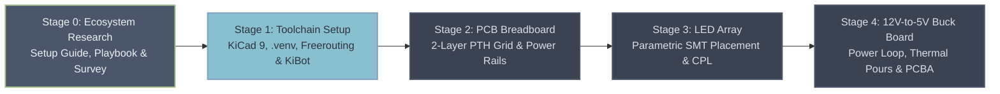

# learn_AI_PCB_design

Open-source AI-assisted **KiCad 9** PCB design, verification, and JLCPCB PCBA fabrication pipeline on **Ubuntu 26.04 LTS**, paired with a progressive hardware testbed (`pcb_breadboard`, `led_array`, `buck_12v_to_5v`) to validate autonomous schematic synthesis, parametric placement, autorouting, 3D mechanical audits, and turnkey manufacturing exports.

---

## 1. Repository Structure

The repository follows the standardized tripartite **Subproject-Driven Architecture** (`RULE-REPO-001`), separating architectural blueprints, KiCad hardware designs, and Python generator/audit scripts into mirrored subprojects:

```text
learn_AI_PCB_design/
├── readme.md                                       # Master repository guide, Mermaid roadmap & status dashboard
├── .gitignore                                      # Python .venv, KiCad backups/locks & DSN/SES scratch rules
│
├── blueprints/                                     # Architectural blueprints, research & immutable project diary
│   ├── diary.md                                    # Append-only daily engineering journal (RULE-DIARY-001)
│   ├── research/                                   # Toolchain setup, practitioner playbook & ecosystem survey
│   │   ├── kicad_setup_guide.md                    # Native KiCad 9 + .venv + Freerouting + KiBot host setup guide
│   │   ├── ai_pcb_design_playbook.md               # 7-stage gated prompting workflow & 3 human review gates
│   │   └── open_source_ai_pcb_comparison.md        # Survey of HaC, MCP, agent harnesses & GPU/CPU autorouters
│   ├── toolchain_setup/                            # Stage 1 (Planned): Host setup blueprint & smoke test evidence
│   ├── pcb_breadboard/                             # Stage 2 (Planned): 2-layer PTH proto breadboard & power rails
│   ├── led_array/                                  # Stage 3 (Planned): Parametric SMT LED matrix & JLCPCB CPL test
│   └── buck_12v_to_5v/                             # Stage 4 (Planned): 12V-to-5V buck regulator, pours & PCBA run
│
├── hw/                                             # KiCad projects, shared libraries, footprints & fab outputs
│   ├── common/                                     # Shared LCSC/custom symbols, footprints, 3D models & KiBot configs
│   └── subprojects/                                # Isolated per-board KiCad designs mirroring blueprints/<board>/
│
└── sw/                                             # Python generators, ERC/DRC audit wrappers & .venv setups
    ├── common/                                     # Shared setup_env.sh, kicad-sch-api & pcbnew utility modules
    └── subprojects/                                # Isolated per-board Python scripts & verification suites
```

---

## 2. Multi-Stage Project Roadmap



### Subproject Breakdown & Ecosystem Status

| Stage | Subproject | Description | Status | Primary Reference |
| :---: | :--- | :--- | :---: | :--- |
| **Stage 0** | **`research`** | Host inspection on Ubuntu 26.04 (`Python 3.14.4`), open-source GitHub workflow survey, toolchain setup blueprint, and 7-stage gated practitioner playbook. | <span style="color: #A3BE8C;">**Completed**</span> | [Setup](blueprints/research/kicad_setup_guide.md) / [Playbook](blueprints/research/ai_pcb_design_playbook.md) / [Comparison](blueprints/research/open_source_ai_pcb_comparison.md) |
| **Stage 1** | **`toolchain_setup`** | Install native `apt` KiCad 9.0.8, `.venv` CAD libraries (`kicad-sch-api`, `circuit-synth`, `kiutils`, `skidl`, `easyeda2kicad`, `kibot`), headless `Freerouting`, and run smoke tests. | <span style="color: #88C0D0;">**Starting Next**</span> | — |
| **Stage 2** | **`pcb_breadboard`** | First validation board: parametric 2.54 mm PTH prototyping grid with silkscreen labels, mounting holes, and power bus rails. Validates `pcbnew` + `kicad-cli` DRC + Gerber export. | <span style="color: #4C566A;">**Planned**</span> | — |
| **Stage 3** | **`led_array`** | Second validation board: parametric SMT LED matrix with current-limiting resistors, connector header, `easyeda2kicad` LCSC parts, `Freerouting`, 3D PNG audit, and JLCPCB BOM/CPL. | <span style="color: #4C566A;">**Planned**</span> | — |
| **Stage 4** | **`buck_12v_to_5v`** | Third validation board: switching 12V-to-5V DC-DC converter testing feedback divider math verification, high-current copper pours, thermal stitching vias, and turnkey PCBA release. | <span style="color: #4C566A;">**Planned**</span> | — |

---

## 3. Core Design Workflow Summary

Every hardware subproject follows the **7-Stage Gated AI PCB Workflow** documented in [ai_pcb_design_playbook.md](blueprints/research/ai_pcb_design_playbook.md) using the environment configured via [kicad_setup_guide.md](blueprints/research/kicad_setup_guide.md):

1. **Architecture & Stackup (`ARCHITECTURE.md`)** -> **LCSC Sourcing & Datasheet Pin Matrix (`BOM_CONNECTIONS.md`)** -> **Human Gate 1 (Pinout Sign-Off)**.
2. **Programmatic Schematic & ERC (`.kicad_sch`)** -> **Parametric Placement, Routing & Copper Pours (`.kicad_pcb`)** -> **3D Raytraced Render & `.step` Inspection** -> **Human Gate 2 (3D Fit Sign-Off)**.
3. **Electrical/Thermal/DFM Pre-Flight Audit (`AUDIT.md`)** -> **Turnkey `KiBot` Gerber + JLCPCB BOM/CPL Package** -> **Human Gate 3 (Vendor Portal Preview Sign-Off)**.

Chronological decisions, dead ends, and breakthroughs are logged immutably in [diary.md](blueprints/diary.md), and toolchain trade-offs are tracked in [open_source_ai_pcb_comparison.md](blueprints/research/open_source_ai_pcb_comparison.md).
